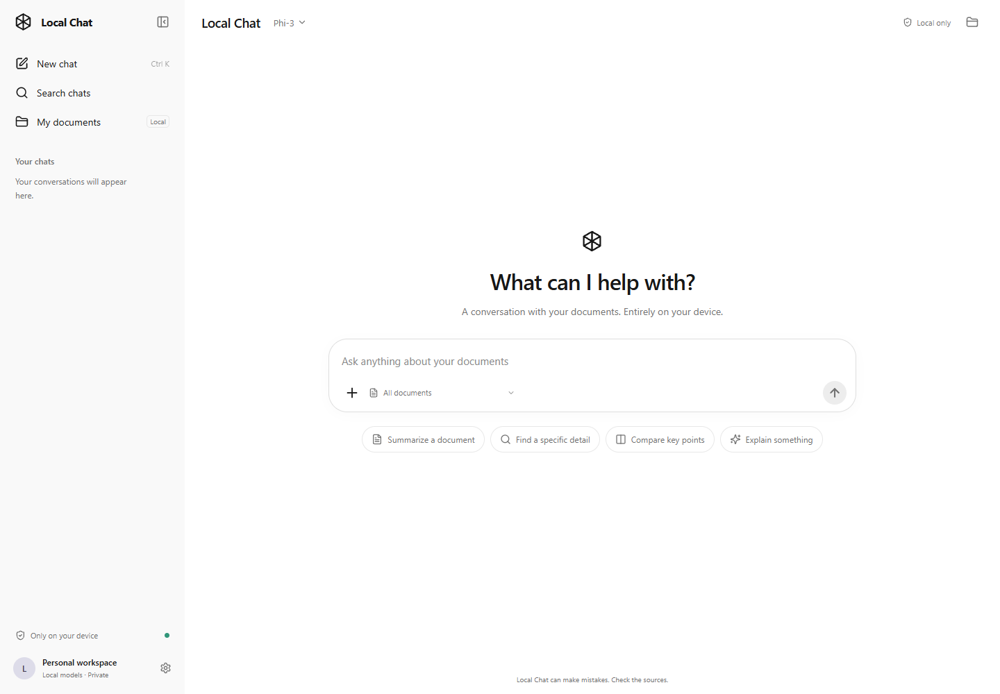
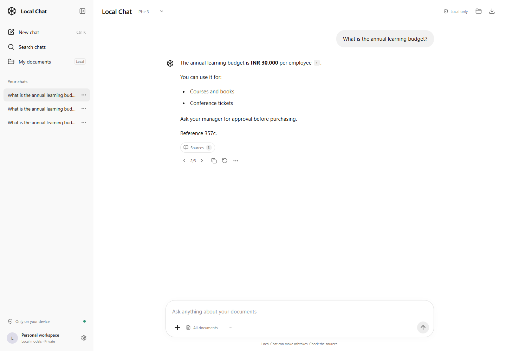

# Local Chat

A ChatGPT-style interface built in **React JavaScript**, backed by a local **FastAPI, Ollama, and Chroma** service. Chat with PDF, DOCX, and TXT documents, inspect sources, stop generation, and switch between response versions. No cloud API key is needed.

## Screenshots

The desktop interface with the chat sidebar and document-aware composer.



A sample conversation showing source citations, regeneration, and response version controls.



## Start on this machine

Start Rancher Desktop so the local Ollama container can run. The Python environment, React dependencies, and models are installed in this checkout.

```powershell
.\scripts\start-local.ps1
```

Open **http://localhost:8501**. FastAPI serves the compiled React interface and the API on the same local port. This checkout's `.env` selects `phi3` and `nomic-embed-text`. If Ollama's container is stopped, use `docker compose up -d ollama`.

After changing React source files, stop the app and rebuild with:

```powershell
.\scripts\start-local.ps1 -BuildFrontend
```

The launcher creates a Python environment if needed, installs missing API dependencies, and builds React if `frontend/dist` is missing. A fresh setup requires **Python 3.12** and **Node.js 22.12 or newer**. Initial package and model downloads need internet; the installed app can run offline.

## Use it

- **New chat** opens a fresh conversation. Chats are saved locally, appear in the sidebar, and can be searched, renamed, or deleted. Ctrl+K (Cmd+K on Mac) starts a new chat.
- Click **+** to upload documents or choose from the library. You can also drag files into the window. Files are indexed locally before you send your question.
- Use the document selector in the composer to search all documents, attached files, or a specific document. Enter sends; Shift+Enter adds a newline.
- Click the **square Stop button** in the composer to stop generation. Partial answers remain saved. A retry or regeneration creates a new response version.
- The **previous/next arrows** below an answer switch versions. Each retains its text, sources, model, timestamp, and status. Switching versions also restores that version's follow-up conversation. Regeneration uses the selected chat model and the original question's document scope and passage count.
- Click a numbered citation or **Sources** to inspect the passages supplied to the model. PDF excerpts include page numbers.
- **My documents** manages the indexed library. Removing a document also removes saved chats that cite it, including inactive response branches. Other chats remain intact.
- **Settings** provides light/dark/system appearance, model selection, passage count, and Ollama connection refresh.
- The header's **download button** exports the conversation and all saved response branches as JSON (`schema_version: 2`).

Switching conversations stops a running response and saves its partial text. Stop closes an active model HTTP stream; a document lookup already running may finish in the background, but its result is discarded. CPU model startup can take several minutes; subsequent answers are faster while the model remains loaded.

Try `samples/handbook.txt` and ask **What is the annual learning budget?** The answer should be **INR 30,000** with a source reference. Ask **What is the CEO's birthday?** to check the missing-information response.

## Add knowledge or try fine-tuning

Upload PDF, DOCX, or TXT files with **+** to add searchable knowledge. RAG retrieves relevant passages for each question; uploads and saved conversations do not change model weights.

For a consistent report, try asking: **Summarize this document using exactly these headings: `## Summary`, `## Findings`, `## Next steps`. Cite factual claims and clearly label recommended actions.**

With Ollama running, try the sample handbook through the real upload and chat API in a separate temporary workspace:

```powershell
.\.venv\Scripts\python.exe scripts/report_demo.py
```

This checks the budget answer, citation presence, report headings, and an unsupported question. It saves the generated report and check results under ignored `artifacts/report-demo/`. These checks do not verify every claim against the source; inspect the generated report for added conditions or unsupported details. CPU generation can take several minutes.

An optional [report-format fine-tuning experiment](training/README.md) includes fictional JSONL examples, separate evaluation data, offline dataset validation, and a CUDA QLoRA training script. Training requires a compatible GPU and a separate Python environment. It does not replace the app's current model automatically.

## React development

Start the local Python API in one terminal:

```powershell
.\.venv\Scripts\python.exe -m uvicorn api:app --host 127.0.0.1 --port 8501 --reload
```

In another terminal:

```powershell
cd frontend
npm ci
npm run dev
```

Open **http://localhost:5173**. Vite forwards `/api` requests to the local Python server. Build with `npm run build`; the API then serves the build at port 8501. The frontend uses React, Vite, local SVG icons, and Markdown rendering. It does not fetch fonts, analytics, or remote document images.

## Run both services with Docker

Start Rancher Desktop or Docker Desktop with Linux containers, then run:

```powershell
.\scripts\start-docker.ps1
```

The multi-stage Docker build compiles React with Node, then serves it from the Python API image. The script starts Ollama and downloads `nomic-embed-text` and `phi3`. Open **http://localhost:8501**. Stop an existing native app first if it is using port 8501.

To use the larger model from the original requirements:

```powershell
.\scripts\start-docker.ps1 -ChatModel 'llama3.1:8b'
```

Or use Compose directly:

```text
docker compose up --build -d
docker compose exec ollama ollama pull nomic-embed-text
docker compose exec ollama ollama pull phi3
```

Compose reads `.env`; this checkout selects Phi-3. Phi-3 uses a 4,096-token context to reduce memory use. The Compose setup uses CPU inference and binds published ports to `127.0.0.1`.

## Configuration and storage

| Variable | Default | Purpose |
| --- | --- | --- |
| `OLLAMA_BASE_URL` | `http://127.0.0.1:11434` | Local Ollama; Compose uses `http://ollama:11434`. |
| `LLM_MODEL` | `llama3.1:8b` | Initial chat model; local `.env` selects `phi3`. |
| `EMBEDDING_MODEL` | `nomic-embed-text` | Document embedding model. |
| `DATA_DIR` | `<project>/data` | Local persistent storage; Compose uses `/app/data`. |

Explicit environment variables take precedence over `.env`. Restart the API after changing configuration. Changing the embedding model selects a separate Chroma collection; upload documents into that collection before asking new questions.

- **Documents:** `data/chroma_db` contains extracted text, vectors, and file metadata. Existing indexed documents are reused by the React app.
- **Conversations:** `data/conversations.sqlite3` contains chat names, messages, all response versions, sources, and follow-up branches. This history survives browser and server restarts. An interrupted response is restored as stopped.
- **Docker:** `document_data` stores both databases; `ollama_models` stores model weights. They survive `docker compose down`. `docker compose down -v` permanently deletes the volumes.

Uploaded originals are not retained after indexing. Identical contents are skipped even when renamed. Changed contents with the same filename are separate entries. Uploads are limited to 25 MB; TXT files must use UTF-8. Scanned PDFs need OCR before upload, encrypted PDFs need an unlocked copy, and DOCX headers/footers and embedded images are not indexed. Previously exported conversation files remain on your disk when you delete chats or documents in the app.

The prompt asks the local model to use only retrieved excerpts and respond `I cannot find this information in the uploaded document.` when unsupported. Models can still make mistakes; inspect the sources. Follow-ups are retrieved using the current question, so include the subject for better retrieval.

The app accepts only local Ollama endpoints and rejects cloud model names. Compose sets `OLLAMA_NO_CLOUD=1`. LangChain tracing and Chroma telemetry are disabled. For native Ollama, set `OLLAMA_NO_CLOUD=1` on the Ollama server process and restart it; see [Ollama's local-only configuration](https://docs.ollama.com/faq#how-do-i-disable-ollama-cloud-features). The app is a personal local workspace without account authentication; keep its loopback binding.

## Checks

```powershell
.\.venv\Scripts\python.exe -m unittest discover -s tests -v
cd frontend
npm test
npm run build
```

Python checks cover document parsing, Chroma persistence, cancellation (including actual HTTP disconnection), version branches, chat recovery, and API routes. React tests cover version arrows, stop/send controls, copying, citations, and chat search. They do not require downloaded models.

With Ollama and both models installed, verify real retrieval and answers using a temporary document library:

```powershell
.\.venv\Scripts\python.exe scripts/smoke_test.py
```

## Troubleshooting

- **Ollama offline or missing models:** open Settings, start Ollama, pull the shown models, and refresh the connection.
- **Docker not on PATH:** `scripts/start-docker.ps1` detects standard Rancher Desktop and Docker Desktop installation paths.
- **Port in use:** stop the old Streamlit/API process before launching the React app on port 8501.
- **ImportError after updating Python modules:** restart the API process so the updated modules load together. For a Docker app, rebuild with `docker compose up --build -d app`.
- **React changes not visible:** run `scripts/start-local.ps1 -BuildFrontend`, or use Vite's development server for automatic updates.
- **Slow first answer / memory pressure:** select Phi-3. This Compose file does not enable GPU acceleration.
- **Rancher localhost connection resets:** restart/update Rancher Desktop; see [the Windows loopback forwarding issue](https://github.com/rancher-sandbox/rancher-desktop/issues/7720).
- **Model download DNS/TLS failure:** retry `ollama pull` after connectivity recovers. Both downloads must finish before chat can work.

## Code map

`frontend/src` contains the React interface. `api.py` exposes local API routes and serves the build. `chat_store.py` persists conversations, `conversation.py` manages versions and branches, `generation.py` runs cancellable responses, `chat.py` builds local model prompts, `ingest.py` handles parsing and Chroma storage, and `config.py` holds runtime settings.
